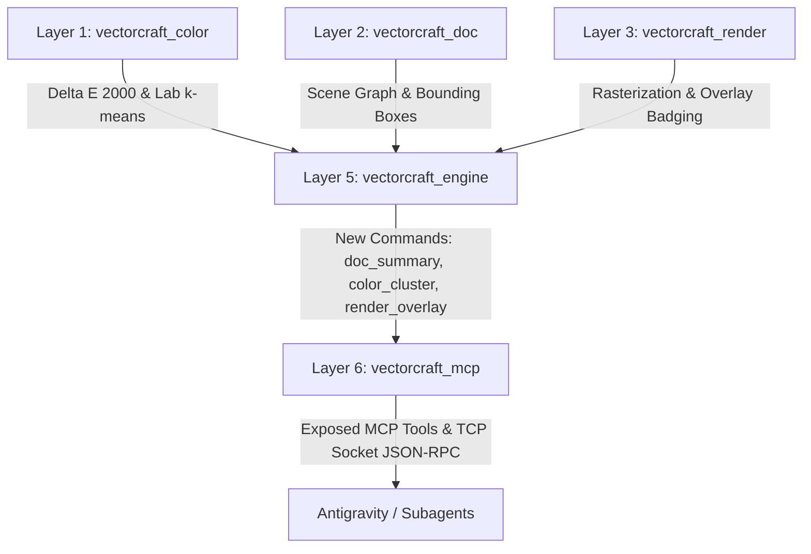

# Design Specification: Native VectorCraft Agent Extensions & Cognitive Tooling

**Date**: 2026-10-12  
**Status**: Draft (Approved in Brainstorming)  
**Target Crates**: `crates/color`, `crates/engine`, `crates/mcp`, `crates/render`  
**Authors**: Antigravity & User  

---

## 1. Executive Summary & Motivation

Interacting with VectorCraft through low-level TCP commands or raw MCP calls during complex illustration tasks (such as color grouping, layer restructuring, and perceptual analysis) revealed three major friction points:
1. **Context Window Exhaustion**: Querying raw document graphs (`document.inspect` / `doc.inspect`) dumps thousands of bezier coordinate floats, consuming 20k+ tokens and triggering conversational compaction.
2. **Visual-Spatial Blindness**: Coordinate tuples like `[491.52, 491.52]` do not indicate semantic roles (e.g. whether a node is a canvas background card or a ship's window). Agents require visual grounding that correlates rendered artboards with exact node IDs.
3. **Ad-Hoc Tooling Overhead**: Operations requiring perceptual color math ($\Delta E_{00}$) or multi-path reordering currently rely on ad-hoc external scripts written to temporary directories, introducing quotation escaping issues and manual transaction handling.

This specification defines **Native VectorCraft Agent Extensions**: built-in engine commands and first-class MCP tools that provide semantic document summarization, engine-native CIEDE2000 clustering, and visual debug overlays with labeled node badges.

---

## 2. Architecture & Layering Alignment

VectorCraft strictly enforces crate layering (`cargo xtask layers`). The extensions are distributed across the system layers to ensure no circular dependencies or abstraction leaks:



### Crate Allocations
1. **`crates/color` (Layer 1)**:
   - Exposes public clustering primitives `cluster_nodes_by_lab` utilizing existing `cms::delta_e2000` and `recolor::cluster`.
2. **`crates/engine` (Layer 5)**:
   - `crates/engine/src/inspect.rs`: Implements `document.semantic_summary` (bounds analysis, background card identification, and palette frequency aggregation).
   - `crates/engine/src/cmd/colorcmds.rs`: Implements `color.cluster` for dry-run preview and atomic document grouping.
   - `crates/engine/src/cmd/render.rs`: Implements `render.overlay` for drawing translucent bounding boxes and high-contrast numerical ID badges onto rendered artboard frames.
3. **`crates/mcp` (Layer 6)**:
   - `crates/mcp/src/tools.rs`: Declares JSON schemas and executes dispatch for `semantic_summary`, `cluster_colors`, and `render_overlay`.

---

## 3. Engine Command Specifications

### 3.1 `document.semantic_summary`
- **Method**: `document.semantic_summary`
- **Menu Path**: Query command (non-mutating)
- **Input Parameters**:
  ```json
  {
    "type": "object",
    "properties": {
      "selection_only": { "type": "boolean", "description": "Summarize only selected nodes (default: false)" },
      "include_palette": { "type": "boolean", "description": "Include color histogram (default: true)" },
      "max_palette_entries": { "type": "integer", "minimum": 1, "maximum": 256, "description": "Max distinct colors to report (default: 32)" }
    }
  }
  ```
- **Execution Logic**:
  - Traverses the active layer tree without serializing raw bezier segments.
  - Compares node geometric bounds against artboard dimensions ($\pm 1\%$ tolerance). A node that matches the artboard rectangle and resides at index 0 (bottom of the z-stack) is flagged as `background_card_id`.
  - Aggregates fill and stroke colors into an RGB/Hex frequency map.
  - Tallies grouped nodes vs loose (orphan) paths.
- **Return Contract**:
  ```json
  {
    "artboard": { "width": 491.52, "height": 491.52 },
    "background_card_id": 178,
    "total_nodes": 139,
    "group_count": 20,
    "loose_path_count": 22,
    "palette": [
      { "hex": "#f5e7bc", "count": 3, "sample_node_ids": [335, 315, 277] },
      { "hex": "#911d21", "count": 8, "sample_node_ids": [240, 291, 211] }
    ],
    "z_order_summary": { "lowest_id": 178, "highest_id": 305 }
  }
  ```

---

### 3.2 `color.cluster`
- **Method**: `color.cluster`
- **Menu Path**: `Object ▸ Color ▸ Cluster Similar...`
- **Input Parameters**:
  ```json
  {
    "type": "object",
    "required": ["max_delta_e", "action"],
    "properties": {
      "node_ids": { "type": "array", "items": { "type": "integer" }, "description": "Nodes to cluster (default: loose paths)" },
      "max_delta_e": { "type": "number", "minimum": 0.0, "maximum": 100.0, "description": "Maximum CIEDE2000 distance to merge" },
      "action": { "type": "string", "enum": ["preview", "group", "merge_existing"], "description": "Execution action" }
    }
  }
  ```
- **Execution Logic**:
  - Validates that `max_delta_e.is_finite()`.
  - Collects target nodes and their primary fill colors (falling back to stroke if fill is None).
  - Converts colors to Lab space via `Color::to_lab()`.
  - Executes weighted k-means clustering (`vectorcraft_color::recolor::cluster`) with distance threshold $\Delta E_{00} \le \text{max\_delta\_e}$.
  - Under `action == "preview"`: Returns proposed cluster buckets without document mutations.
  - Under `action == "group"`: Creates new group nodes (`Color #<hex>`) and reparents matching paths inside an atomic transaction.
  - Under `action == "merge_existing"`: Scans existing groups matching `Color #<hex>`, calculates distance to representative color, and reparents matching paths if $\Delta E_{00} \le \text{max\_delta\_e}$.
- **Return Contract**:
  ```json
  {
    "clusters": [
      { "group_name": "Color #f5e7bc", "hex": "#f5e7bc", "node_ids": [335, 315, 277], "avg_delta_e": 0.42 }
    ],
    "unmatched_ids": [178],
    "modified_node_count": 3
  }
  ```

---

### 3.3 `render.overlay`
- **Method**: `render.overlay`
- **Menu Path**: Query command
- **Input Parameters**:
  ```json
  {
    "type": "object",
    "required": ["path"],
    "properties": {
      "node_ids": { "type": "array", "items": { "type": "integer" }, "description": "Specific nodes to annotate" },
      "ungrouped_only": { "type": "boolean", "description": "Filter to ungrouped paths only" },
      "path": { "type": "string", "description": "Target PNG file path" },
      "scale": { "type": "number", "minimum": 0.1, "maximum": 8.0, "description": "Render scale factor (default: 2.0)" }
    }
  }
  ```
- **Execution Logic**:
  - Renders base document using `vectorcraft_render`.
  - Computes screen-space bounding boxes for target nodes.
  - Overlays a debug pass:
    - 1px translucent bounding box per object.
    - High-contrast pill badge with node ID centered at the top-left of the bounding box.
  - Encodes directly to PNG at target path.
- **Return Contract**:
  ```json
  {
    "path": "s:/Github/vectorcraft/scratch/annotated_overlay.png",
    "annotated_count": 22,
    "dimensions": { "width": 983, "height": 983 }
  }
  ```

---

## 4. MCP Server Tool Declarations

The tools are registered in `crates/mcp/src/tools.rs`:

```rust
tool(
    "semantic_summary",
    "Get Semantic Document Summary",
    "Returns a token-efficient summary of the active document: artboards, canvas background card ID, total group and loose path counts, dominant color palette frequency, and z-order boundaries without dumping raw bezier points.",
    obj(
        json!({
            "selection_only": {"type": "boolean", "description": "Only summarize selected nodes"},
            "max_palette_entries": {"type": "integer", "description": "Maximum color swatches to include (default 32)"}
        }),
        &[],
    ),
    true,
),
tool(
    "cluster_colors",
    "Cluster Nodes by Perceptual Color",
    "Groups or previews nodes clustered by perceptual color distance (CIEDE2000). Action 'preview' returns proposed groups without mutation. Action 'group' creates new named color groups atomically. Action 'merge_existing' merges nodes into existing color groups.",
    obj(
        json!({
            "node_ids": {"type": "array", "items": {"type": "integer"}, "description": "Node IDs to cluster"},
            "max_delta_e": {"type": "number", "description": "CIEDE2000 distance threshold (e.g. 5.0)"},
            "action": {"type": "string", "enum": ["preview", "group", "merge_existing"], "description": "Execution action"}
        }),
        &["max_delta_e", "action"],
    ),
    false,
),
tool(
    "render_overlay",
    "Render Labeled Visual Overlay",
    "Exports an annotated PNG image of the artboard displaying semi-transparent bounding boxes and high-contrast numbered badges for specified nodes.",
    obj(
        json!({
            "node_ids": {"type": "array", "items": {"type": "integer"}, "description": "Node IDs to label"},
            "ungrouped_only": {"type": "boolean", "description": "Only label ungrouped paths"},
            "path": {"type": "string", "description": "Absolute output path for the PNG"},
            "scale": {"type": "number", "description": "Raster scale factor (default 2.0)"}
        }),
        &["path"],
    ),
    true,
)
```

---

## 5. Non-Negotiable Invariants & Safety Protocols

1. **No-Panic Guarantee**:
   - `unwrap()`, `expect()`, `panic!`, `todo!`, and `unimplemented!` are forbidden in shipped code and strictly enforced by CI clippy lints.
   - All float inputs must be checked with `.is_finite()`.
   - All slice indexing must use `.get()`.
2. **Atomic Undo Guarantee**:
   - Mutating commands (`color.cluster` with `group` or `merge_existing`) wrap all reparenting and group creation in a single `Session::edit("Cluster by Color", |doc, sel| { ... })` closure. If any error occurs, the entire transaction is rolled back with zero document corruption.
3. **Concurrency Boundary**:
   - Subagents run concurrent read-only queries (`semantic_summary`, `render_overlay`, `cluster_colors(preview)`).
   - Document mutations are serialized through the engine transaction lock.
4. **Clean-Room Enforcement**:
   - Algorithms derived exclusively from public specifications (CIE 11664-6:2014, W3C SVG 1.1 / 2.0).
   - No Adobe binaries, headers, presets, or test fixtures are referenced or copied.

---

## 6. Toolchain Bootstrapping & Build Plan

1. **Host Environment Setup**:
   - Install Rustup via Windows Package Manager:
     `winget install Rustlang.Rustup -h --accept-source-agreements --accept-package-agreements`
   - Configure default host toolchain (`stable-x86_64-pc-windows-msvc`).
   - Refresh shell environment variables to access `cargo` and `rustc`.
2. **Build Configuration**:
   - Configure isolated `CARGO_TARGET_DIR` (e.g. `s:/cargo_target` or `.target/`) to prevent disk saturation per `AGENTS.md`.
   - Build binaries:
     `cargo build --release -p vectorcraft -p vectorcraft-cli`
3. **Quality Gates**:
   - Run lints: `cargo clippy --all-targets -D warnings`
   - Run layer checks: `cargo xtask layers`
   - Run test suite: `cargo test -p vectorcraft_color -p vectorcraft_engine -p vectorcraft_mcp`

---

## 7. Verification Matrix

| Test ID | Area | Scenario | Expected Outcome |
| :--- | :--- | :--- | :--- |
| **TEST-01** | `vectorcraft_color` | Synthetic RGB/Lab clusters with varying $\Delta E_{00}$ | Exact clustering matching CIE2000 math; handles empty & single inputs |
| **TEST-02** | `vectorcraft_engine` | `semantic_summary` on 139-path illustration | Correctly identifies canvas card ID 178, reports 20 groups, 22 loose paths |
| **TEST-03** | `vectorcraft_engine` | `color.cluster` preview mode | Returns cluster JSON without mutating document or dirtying state |
| **TEST-04** | `vectorcraft_engine` | `color.cluster` group mode | Creates groups, moves paths, single undo restores original layout |
| **TEST-05** | `vectorcraft_render` | `render.overlay` on loose paths | Emits valid PNG with numbered badges positioned at node bounds |
| **TEST-06** | `vectorcraft_mcp` | MCP tool call dispatch & schema validation | Tools respond accurately over JSON-RPC protocol |
| **TEST-07** | Quality Gates | `cargo xtask layers` & `cargo clippy -D warnings` | Zero layer violations; zero forbidden panics |
